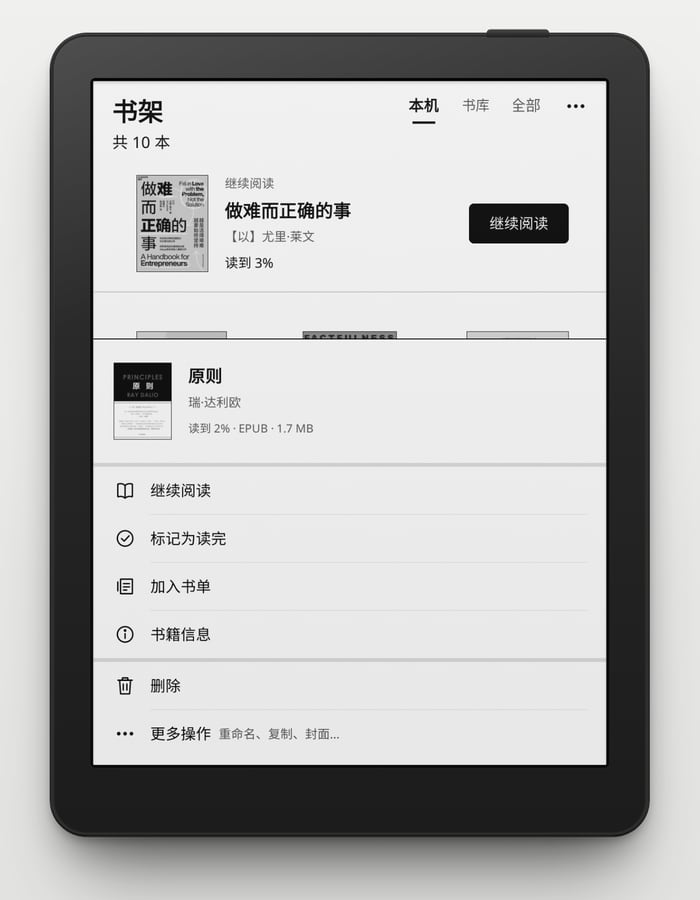
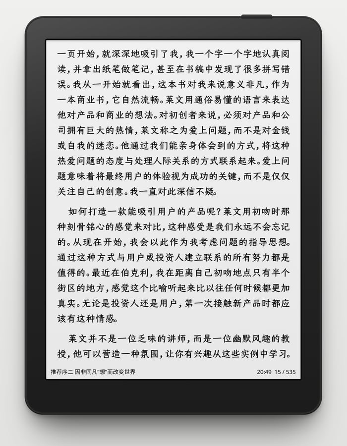
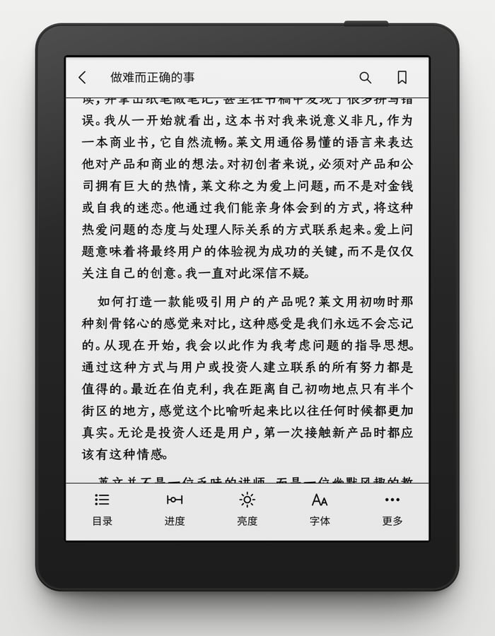
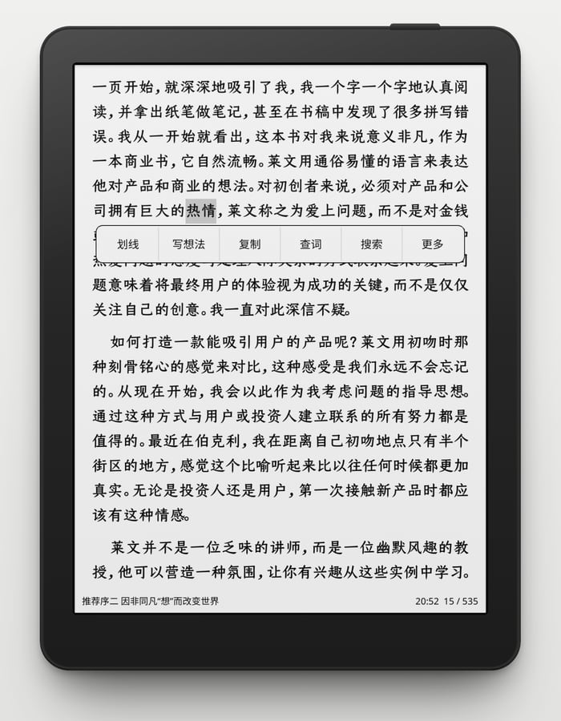
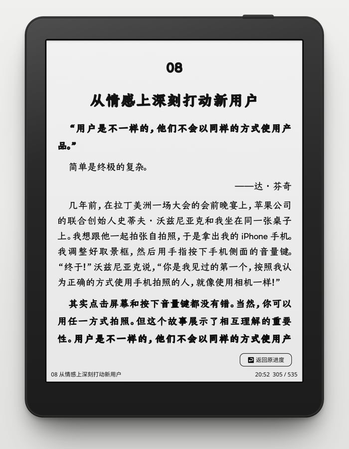
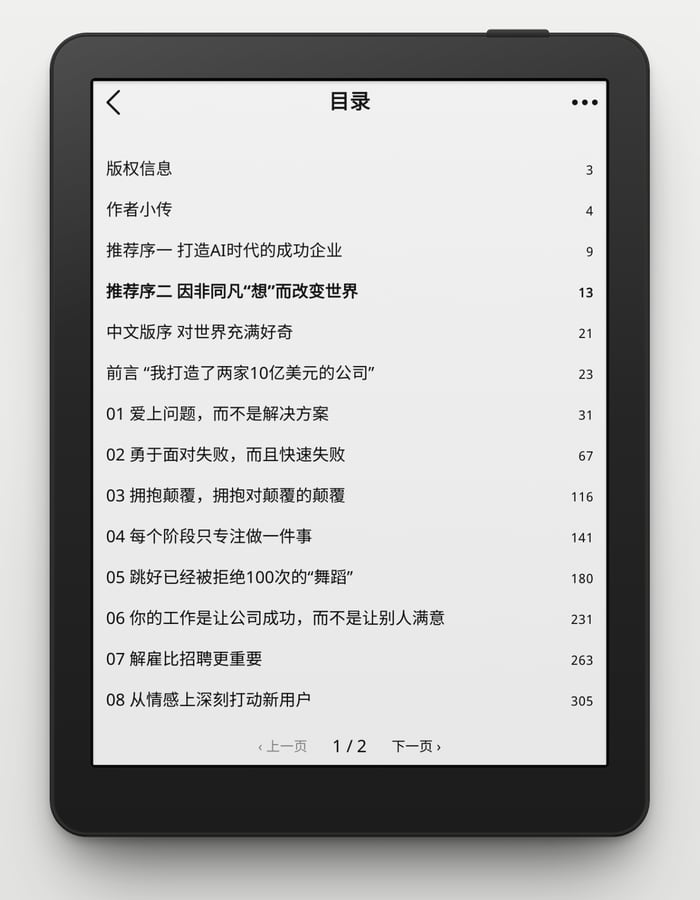
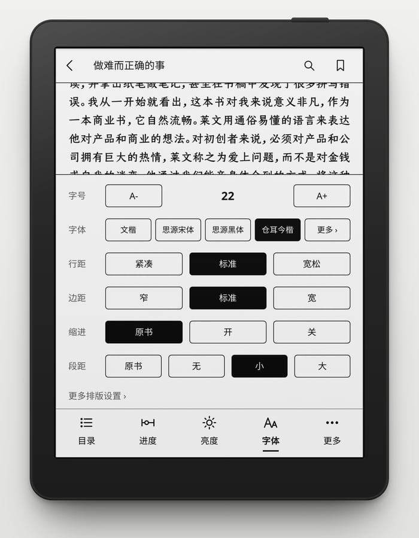
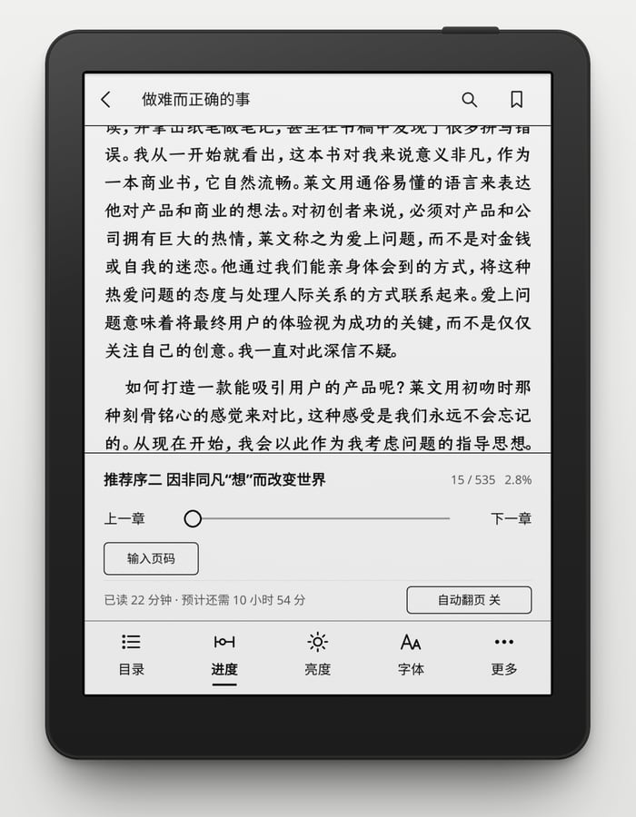
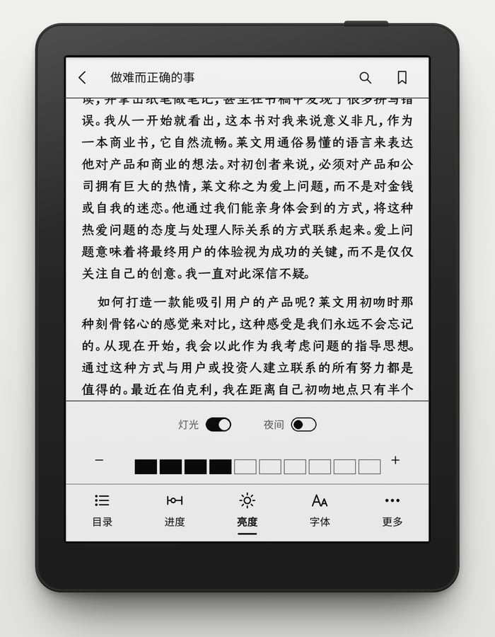
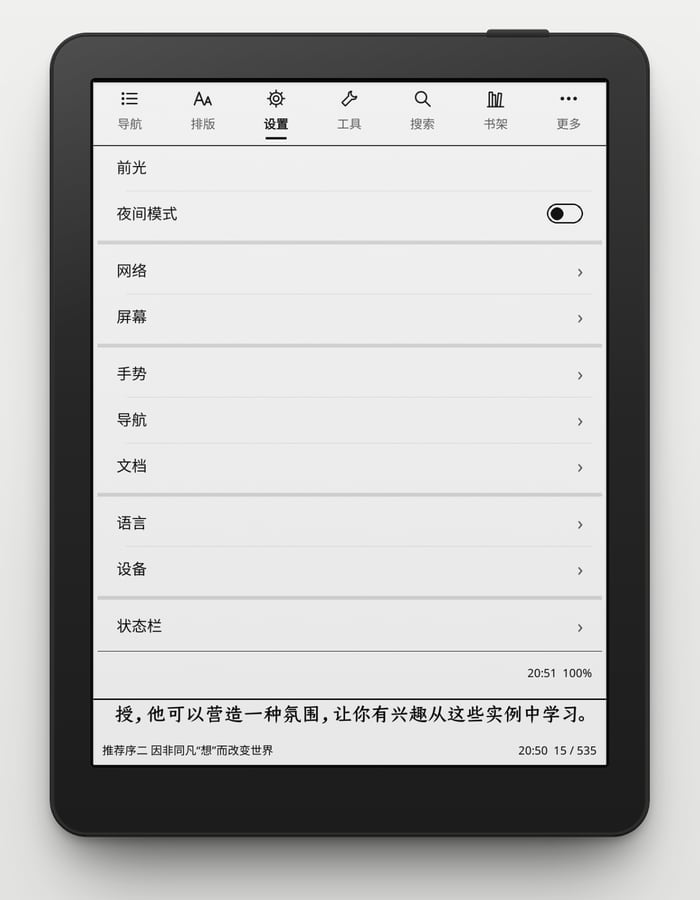

<div align="center">

# kindle-koreader-setup

**一句话，让 AI 把你的 Kindle 配成 KOReader + 中文电纸书界面**

[](https://skills.sh)
[](https://github.com/koreader/koreader/releases/tag/v2026.07.1)
[](COPYING)


</div>

这是一个 [Agent Skill](https://skills.sh)，适用于 Claude Code、Codex、Cursor 等 AI 编程工具。装好以后接上 Kindle，对 AI 说一句话，它会判断你的设备状态，从越狱、防自动更新、安装 KOReader，一直带你装好这套中文界面。

界面本身是 [KOReader](https://github.com/koreader/koreader) 的修改版：只改了 Lua 前端，原有功能和设置全部保留，让它在墨水屏上入口更少、常用设置一屏调完、黑白分明。

## 快速开始

**1. 安装 skill**（需要 Node.js 22.20 或更新）

```bash
npx skills add okooo5km/koreader --skill kindle-koreader-setup
```

**2. 用数据线把 Kindle 接到电脑**，在 AI 工具里说：

> 帮我在这个 Kindle 上连接并安装 KOReader

AI 会先检查 Kindle 当前处在哪一步，再从对应的位置开始：

| Kindle 现在的状态 | AI 会做什么 |
|---|---|
| 原厂，没越狱 | 查机型和固件 → 选越狱方法 → 防自动更新 → 带你越狱 → 装 KOReader → 装界面 |
| 已越狱，没装 KOReader | 装 KOReader v2026.07.1 → 装界面 |
| 已装 KOReader | 版本不对先重装 v2026.07.1（书和设置会备份）→ 装界面 |

越狱中有几步需要你在 Kindle 上亲手点，AI 会说清楚每一步该看到什么。

## 界面一览

| | | |
|:---:|:---:|:---:|
|  |  |  |
| **书架**<br>继续阅读卡置顶，封面网格，微信读书 / 本机 / 书库切换 | **长按书**<br>继续阅读、标记读完、加入书单、书籍信息 | **阅读页**<br>页脚只留章节名、电量、时间、页码 |
|  |  |  |
| **阅读工具栏**<br>点屏幕中央呼出，所有入口在一条栏上 | **选中文字**<br>中文按词选取，常用操作一行排开 | **返回原进度**<br>跳到目录或搜索结果后一键回来 |
|  |  |  |
| **目录**<br>当前章节加粗，分页翻看 | **排版**<br>字号、字体、行距、边距、缩进、段距 | **进度**<br>阅读时长、预计剩余、自动翻页 |
|  |  | |
| **亮度**<br>灯光、夜间开关，暖光机型另有色温 | **设置菜单**<br>原版菜单全部保留，样式统一 | |

## 微信读书

书架右上角第一个标签就是「微信读书」，由开源插件 [weread.koplugin](https://github.com/finlater/weread.koplugin)（作者 finlater，AGPL-3.0）提供，随界面一起装好。插件文件原样分发，界面在运行时换成同一套风格：

- 书架与本机同一个页头、继续阅读卡和封面网格；**单击直接读**（按云端进度打开对应章节，没下载的只下这一章），**长按看详情**；关书回到微信读书页。
- 书籍详情：封面、推荐值、字数、阅读进度，「阅读」「下载全书」主按钮，章节目录、书评。
- 阅读页按全书口径：顶栏书名、全书目录、上一章 / 下一章跨章节、章末自动接下一章；全书页码按已读章节的累计字数估算，换章不跳。

**安装包里不带任何账号信息。** 第一次点「微信读书」会看到登录页：先在手机微信读书「我 › 设置 › 微信读书 Skill」里获取 API Key，再在 Kindle 上点「扫码登录」，用微信扫码，手机确认页勾选「自动退出登录」后确认（不勾会报 HTTP 401）。账号只保存在这台 Kindle 的 `koreader/settings/weread.lua` 里。

本项目与微信读书、腾讯无关，插件为第三方非官方项目，请遵守微信读书用户协议。

## 支持的设备

KOReader 支持、并且当前固件有可用越狱的 Kindle 都可以：Paperwhite、Oasis、Voyage、入门款、Scribe、Colorsoft 等。

- **能不能越狱**由 [Kindle Modding Wiki](https://kindlemodding.org/jailbreak-wizard.html) 的实时数据决定，skill 运行时现场查，不靠写死的表。
- **部分最新机型暂时没有越狱方法**（例如 2026 款 Paperwhite），skill 会告诉你保持飞行模式等待，不要升级固件。
- **界面按屏幕短边等比缩放**，竖屏、横屏、大屏都能正常排版；带暖光的机型多一条色温调节。

电脑：macOS、Linux 可以全自动；Windows 也能用，AI 会把脚本步骤换成手动操作。需要 `git`、`curl`、`python3`、`rsync`、`unzip`。

## 手动安装

已经越狱、能运行 KOReader 的话，也可以不用 AI：

1. 确认 Kindle 上的 KOReader 是 **v2026.07.1**。不是的话从[官方 releases](https://github.com/koreader/koreader/releases/tag/v2026.07.1) 重装：固件 5.16.3 及以上用 `kindlehf`，更低固件的触屏机型用 `kindlepw2`。
2. 在 KOReader 里退出，用数据线连接电脑。
3. 从本仓库 [Releases](https://github.com/okooo5km/koreader/releases) 下载 `koreader-kindle-overlay-*.zip`，解压到 Kindle 根目录，覆盖 `koreader/` 里的同名文件（不要删除原有文件）。
   macOS 上用 `ditto -x -k <zip> /Volumes/Kindle`，然后执行 `dot_clean -m /Volumes/Kindle`。
4. 弹出、拔线，再启动 KOReader。

覆盖前请备份 `koreader/` 目录，回退时拷回即可。

## 仓库结构

```
skills/kindle-koreader-setup/   Agent Skill：说明、脚本、参考文档
  scripts/jb_lookup.py          按序列号和固件查越狱方法（读 Kindle Modding Wiki 实时数据）
  scripts/koreader_install.sh   安装官方 KOReader v2026.07.1
  scripts/ui_install.sh         备份后覆盖界面
  scripts/ui_rollback.sh        回退界面
frontend/ plugins/ resources/   界面代码（KOReader Lua 前端的修改版）
docs/screenshots/               本页截图
```

## 注意

- 界面只适配 **KOReader v2026.07.1**，换别的版本会崩。
- 越狱会脱离官方支持，可能影响保修；Amazon 可能拉黑设备；误升级固件会失去越狱，并且无法降级。越狱只用来运行 KOReader 读你自己的书，本项目不提供任何去 DRM 或获取盗版的帮助。
- 字体和词典不随界面附带。中文字体推荐[霞鹜文楷](https://github.com/lxgw/LxgwWenKai)（OFL 协议），放进 `koreader/fonts/`。
- 实机长期使用的是 Kindle Voyage。其他机型遇到布局问题，欢迎[提 issue](https://github.com/okooo5km/koreader/issues)，附上机型、固件和截图。

## 致谢与许可

- [KOReader](https://github.com/koreader/koreader)：本项目的基础，原版说明见 [README.upstream.md](README.upstream.md)。
- [Kindle Modding Wiki](https://kindlemodding.org)：越狱方法与机型数据的来源。

与 KOReader 相同，使用 [AGPL-3.0](COPYING) 许可。
